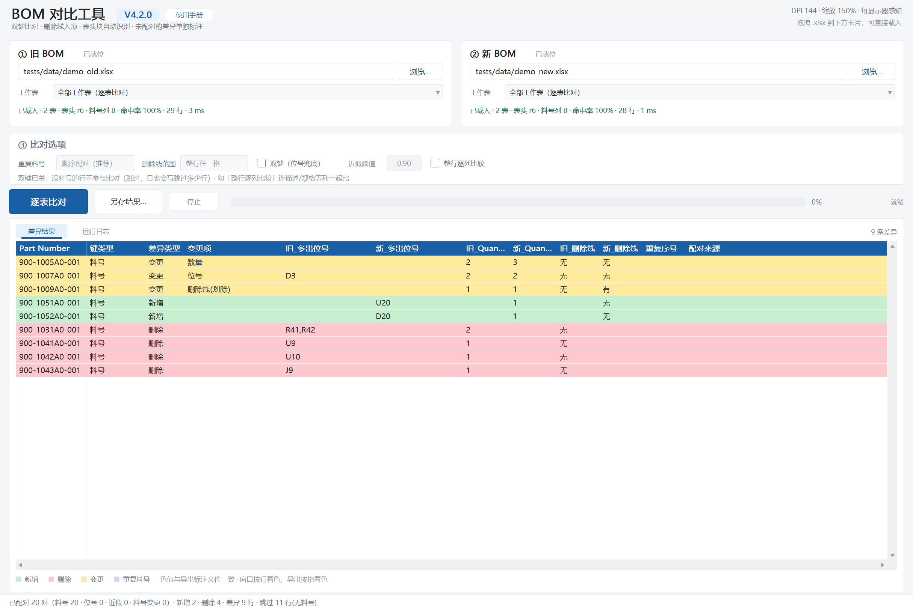

# BOM 对比工具（BOMCheck）

**V4.2.0** ｜ Windows 10 / 11（64 位）｜ 单个 exe，免安装、免 Python、免运行库、不联网

把两份 Excel 版 BOM（旧版 / 新版）丢进程序，直接告出**这版改了什么**：哪些料新增、哪些删了、
同一颗料的位号或数量变了、哪些行只是描述改了。结果写成三份 xlsx —— 一份差异清单，加新旧两份
在原表上涂好色的标注文件。



## 它解决什么问题

电子厂每出一版 BOM，硬件/采购都要回答"这一版跟上一版差在哪"。肉眼看两张几百行的表，漏行是常态；
用 Excel 自带比较又只能逐格对，料号换了行就整行错位。这个工具按**料号 → 位号 → 近似位号**的顺序
给两边的行配对，配对成立之后再比细节，所以"料号没变、位号少了两个"和"料号换了、位号没动"能被区分开。

## 主要能力

| 能力 | 说明 |
|---|---|
| 四阶段配对 | 料号键精确 → 位号键精确（可选）→ 位号 Jaccard 近似（可选）→ 剩余算增删 |
| 12 列差异表 | 料号、键类型、差异类型、变更项、新旧多出位号、新旧数量、新旧删除线、重复序号、配对来源 |
| 三份产物 | `_差异结果.xlsx`（含识别诊断页）+ 旧/新两份原表标注（保留原样式，涂色 + 批注） |
| 多工作表 | 两本都是多页时逐表比对；封面、修订记录页自动跳过 |
| 查重模式 | 新旧选同一个文件 → 找出表内重复料号，出查重表 + 查重标注 |
| 可比口径 | 料号归一化（全角/空白/大小写）、位号集合化（`R1-R3,R5` 展开）、删除线识别 |
| 界面 | 自绘 Win32，PerMonitorV2，150%/200% 不糊；49 个控件由 `pyref/layout_spec.py` 单一数据源生成 |

三个可在界面上调的选项：**双键（位号兜底）**默认关、**近似阈值**默认 0.90、**整行逐列比较**默认关。
双键关掉时，没有料号的行整行跳过（状态栏与日志都会写明跳过了多少行），不会硬凑成一条新增 + 一条删除。

## 构建

依赖：CMake ≥ 3.20、Ninja、MinGW-w64（`gcc` / `g++` / `windres`）、Python 3（只给构建脚本用，需 `openpyxl`）。

```bat
build_c.bat                 :: 生成布局头 → configure → 编译 → 11 项对账 → 打包 → ctest
build_c.bat clean           :: 先清 build\c 再走全流程
```

产物：`build\c\bin\BOMCheck_V4.2.0.exe`（约 690 KB，静态链接）与 `dist\BOMCheck_V4.2.0\{exe, 手册, 控件表}` + 同名 zip。

```bat
bomcheck.exe --self-check                     :: 资源 / manifest / DPI 声明逐项自证
bomcheck.exe --ui-run 旧.xlsx 新.xlsx 输出目录   :: 不开界面跑一遍，给脚本用
bomcheck.exe --version | --bench 100000        :: 版本号 / 性能压测
```

## 目录结构

```
src/core/     纯 C99 引擎：自研 zip / inflate / deflate / XML，读 xlsx、认表头、配对、写结果、标注
src/ui/       Win32 C++17 界面：自绘、OLE 拖放、DPI、自检与各类探针
src/res/      图标、manifest、.rc
tests/        ctest 单测 + 21 份 xlsx 回归样本（18 份构造边界 + 2 份虚构演示 + 1 份重复料号）
tools/        构建与对账脚本（gen_layout_c / gen_demo / pack / md2html / make_layout_doc / check_*）
pyref/        Python 参考实现（oracle）与布局单一数据源 —— 只服务构建与对账，见 pyref/README.md
docs/         设计文档、用户使用手册（md + html）、流程图、控件位置对照表/对照图
CodeReview/   V4.1.6 的第三方审查报告、39 条问题清单、崩溃/挂死复现样本
```

## 质量体系

C 实现与 `pyref/bomcore.py` 是同一份口径的两份实现，对同一批样本各跑一遍再逐格比 —— 语义歧义
无处藏身。`build_c.bat` 的 11 个对账脚本全绿才算构建通过：

`check_xlsx`（读取链逐格）· `check_pn`（料号/位号/键，384 用例）· `check_sheet`（识别，24 张表）·
`check_pair`（配对与 12 列）· `check_write`（写出）· `check_mark`（标注）· `check_fuzz`（18 例畸形输入不崩）·
`check_ui`（界面接线 23 项）· `check_layout`（49 控件三尺寸 0 重叠/0 越界）· `check_exe`（资源与 DPI）·
`check_pack`（干净目录验收）

回归样本全部是**虚构数据**：`tests/data/cases/` 是构造的边界样本，`tests/data/demo_old.xlsx` /
`demo_new.xlsx` 是 `python tools/gen_demo.py` 生成的演示 BOM（料号 `900-…`、厂商 `VendorA…`，
连续两次生成逐字节相同）。README 与手册里的界面截图就跑在这两份上，仓库不含任何客户资料。

V4.2.0 是审查修复版：修了 1 个 P0（异常列号导致越界写崩溃）、1 个永久卡死，以及合并单元格、
诊断口径、查重另存等 9 条 P1。详见 [CodeReview/README.md](CodeReview/README.md) 与设计文档 §13。

## 文档

| 文档 | 读者 |
|---|---|
| [docs/用户使用手册.md](docs/用户使用手册.md) ｜ [网页版](docs/用户使用手册.html) | 使用者：操作步骤、12 列含义、四种颜色、常见问题 |
| [README.txt](README.txt) | 随包说明（`dist/` 里与 exe 放一起的那份） |
| [docs/BOM对比工具_V4_设计与实施.md](docs/BOM对比工具_V4_设计与实施.md) | 维护者：架构、模块职责、比对口径、构建与质量体系、设计决策 |
| [docs/BOM流程图_V4.html](docs/BOM流程图_V4.html) | 八张流程图（节点标文件名），可离线编辑、导出 SVG |
| [docs/GUI控件位置对照图_v4.html](docs/GUI控件位置对照图_v4.html) | 49 个控件的坐标 + 实机截图对照 |

## 已知限制

- 比对与写盘跑在 UI 线程，期间窗口不响应（「停止」按钮目前只是占位）
- 读包侧没有 zip-bomb 上限，也不校验 CRC32
- 只认 `.xlsx`；`.xls` 需先另存
- 整行逐列比较只做文字归一后相等判断，不做数值/单位换算

## 许可

本项目以 [MIT License](LICENSE) 发布。
