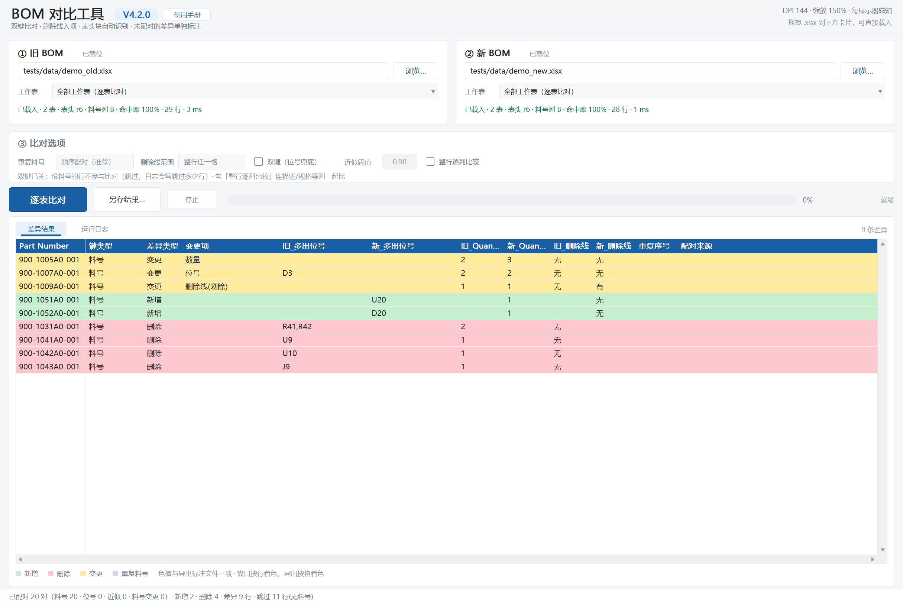

# BOM 对比工具 用户使用手册

**版本 V4.2.0** ｜ 适用 Windows 10 / 11（64 位）

本工具对比两份 Excel BOM（物料清单），找出料号的新增、删除和字段变更，并把差异直接标回原表。全部本地运行，不联网，源文件只读不改。

---

## 一、一分钟上手

1. 双击 `BOMCheck_V4.2.0.exe`。
2. 把**旧 BOM** 拖到左边卡片，**新 BOM** 拖到右边卡片（也可以点「浏览…」选）。
3. 点蓝色的「**逐表比对**」或「**开始比对**」按钮。
4. 到旧 BOM 所在目录的 `checkresults\` 里拿结果 —— 一共三份文件：
   差异清单、旧表标注、新表标注。

不需要安装，不需要 Python，不需要任何运行库。就一个 exe，拷到哪台机器都能跑。

---

## 二、界面导览



| 区域 | 作用 |
|---|---|
| ⓪ 标题栏 | 左边是程序名与版本号（`V4.2.0`），紧跟其后的「使用手册」按钮打开本文件的网页版；右侧是 DPI 状态与拖放提示 |
| ① 旧 BOM 卡片 | 放基准文件。显示已载入的工作表数量、表头行数、料号列、数据行数、识别耗时 |
| ② 新 BOM 卡片 | 放要对比的文件，显示内容同上 |
| ③ 工作表下拉 | 选比哪一页。默认自动挑「数据行最多」的那张；多页工作簿会显示「全部工作表（逐表比对）」 |
| ④ 比对选项 | 重复料号、删除线范围（固定推荐值）；双键、近似阈值、整行逐列比较（可改，改完立刻重算） |
| ⑤ 主按钮 | 「开始比对」/「逐表比对」/「开始查重」，随当前模式自动变化 |
| ⑥ 另存结果… | 换个目录重写一遍 |
| ⑦ 页签 | 「差异结果」（表格）与「运行日志」（文字） |
| ⑧ 图例 | 四种颜色的含义，和写出的标注文件完全一致 |
| ⑨ 状态栏 | 配对统计与当前状态 |

窗口按 PerMonitorV2 声明，150% / 200% 缩放下不会糊、不会错位。

---

## 三、第 1 步：放入两份 BOM

- **拖放**：把文件拖到对应卡片。一次拖两个文件也行，按资源管理器的显示顺序分成「旧 / 新」。
- **浏览**：点卡片右侧「浏览…」选择。
- 卡片头部会显示「已就位」或具体错误（文件被占用、不是 xlsx、表头识别不出来等）。

**旧 / 新 怎么分**：旧 = 基准（比如去年的版本），新 = 要检查的版本。差异方向就是「旧 → 新」：
旧表有、新表没有 = **删除**；新表有、旧表没有 = **新增**。

> 源文件永远只读打开，一个字节都不改。所有输出都写在另一个目录里。

---

## 四、第 2 步：确认工作表

### 单页工作簿

拖进来就完事，不用管下拉。

### 多页工作簿（最常见的情况）

两张卡片的下拉会自动显示「**全部工作表（逐表比对）**」，主按钮变成「**逐表比对**」，日志里会写：

```
两侧各有多张工作表（同名 4 张），已自动切到逐表比对；只想比一张可在工作表下拉里选
```

这时直接点按钮，**所有同名表都会比一遍**，不需要任何额外操作。

- 按「**同名表**」配对：旧表叫 `Main`，就只和新表的 `Main` 比；名字对不上不硬凑。
- 每张表各出一份**差异结果**（文件名带表名）。
- **标注合并成一份**：所有比过的页都涂好色，不用在多个文件之间来回翻。
- 两侧都没有数据行的页（封面、修订记录、空白页）自动跳过，日志写「跳过「天线组件」：两侧都没有数据行」。

### 只想比其中一张

点开工作表下拉，选具体表名即可 —— 按钮会自动变回「开始比对」，其它页不参与。

下拉的第一项始终是「全部工作表（逐表比对）」，点它可以再切回全比。当前选中的那一项右侧标着「当前」。

> 提示：下拉里「当前」标记在哪一行，就代表现在的模式。日志第一行也会写明「开始比对 · 工作表「Main」· 输出目录 …」，比对前扫一眼就知道比的是哪张。

---

## 五、第 3 步：点「开始比对」

配对全自动，四步依次进行：

| 步骤 | 做法 | 什么时候生效 |
|---|---|---|
| 1. 料号直配 | 料号完全相同 → 配成一对（主力，通常占 95% 以上） | 总是 |
| 2. 位号兜底 | 料号对不上，但位号（R101、C22 这类）能对上 → 视为同一颗料 | 勾了「双键」 |
| 3. 位号近似 | 位号大体重合、只差几个（旧 `R1,R2,R3,R4` 对新 `R1,R2,R3,R9`）→ 按重合度配 | 勾了「双键」且重合度 ≥ 近似阈值 |
| 4. 剩余处理 | 实在配不上的，旧表归「删除」、新表归「新增」 | 总是 |
| 5. 无料号行 | 没有料号的行：双键开着按第 2、3 步处理，关着就整行跳过并计数 | 总是 |

进度条走完后，状态栏和结果页签会显示总数，例如（双键关着的默认状态）：

```
已配对 20 对（料号 20 · 位号 0 · 近似 0 · 料号变更 0）· 新增 2 · 删除 4 · 差异 9 行 · 跳过 11 行(无料号)
```

### 三个选项（③ 比对选项）

③ 区有五项，**前两项固定按推荐值执行**（顺序配对、整行任一格），后三项可以改，改完立刻按新参数重算，日志里会多一行「比对选项：…」：

| 控件 | 默认 | 怎么改 | 管哪一步 |
|---|---|---|---|
| 双键（位号兜底） | 不勾（**关**） | 点一下复选框 | 上面的第 2、3 步 |
| 近似阈值 | `0.90` | 点数字框换档（0.40 → 0.50 → 0.60 → 0.70 → 0.80 → 0.90 → 0.95 → 回到 0.40）；鼠标滚轮在框上 ±0.05 微调 | 上面的第 3 步（双键关着时置灰） |
| 整行逐列比较 | 不勾（**关**） | 点一下复选框 | 变更判定：料号 / 位号 / 数量 / 删除线之外的列也比 |

**双键（位号兜底）= 关（启动默认）**

关着时：「没有料号」的行没有键，整行跳过，日志与状态栏会写明跳过了多少行（例如「· 跳过 11 行(无料号)」）。它不会被硬凑成「新增 + 删除」两条 —— 否则同一份文件自己比自己也会冒出一堆假差异。

打开后：料号对不上的行，再拿位号认一遍。BOM 里常见的两种情况都靠它：

- 同一颗料换了料号，位号没变（旧 `R101` → 新 `R101`）→ 配成一对，键类型写「位号(料号变更)」，结果是 1 条变更，而不是「删 1 + 增 1」；
- 旧表这行料号空着（被划掉的旧料、不贴件），新表补上了料号 → 也能配上。

这对演示样本（`tests/data/demo_old.xlsx` ↔ `demo_new.xlsx`）的实测：**关着 = 配对 20 对、差异 9 行；打开（阈值 0.90）= 25 对、11 行；阈值再降到 0.60 = 26 对、10 行**。所以要不要开，取决于你的表里有没有「有料号但需要按位号认」的行。

**近似阈值 = 0.90**

只有双键开着才生效（关着时数字框是灰的，点了不响应）。它衡量两行的位号集合有多像：

```
相似度 = 两行相同的位号个数 ÷ 两行合起来的不重复位号个数
```

≥ 阈值才算同一颗料，按相似度从高到低一对一配。

`0.90` 几乎是「位号必须完全一致」：一行只有一两个位号时，差一个就直接掉到 0.5 ~ 0.67，配不上；只有 19 个位号以上的超长行，差一个才还能过线。`0.60` 则宽松得多，十个位号里重上六七个就认。

这对演示样本里有 1 对是靠近似配上的（两行位号合起来 8 个、相同 7 个，相似度 0.875）：阈值 0.60 时它算一条「变更」；调到 0.90 就配不上，变成一条删除 + 一条新增，差异从 10 行变 11 行。

**整行逐列比较 = 关**

默认只比四样：料号、位号集合、数量、删除线。其余列（描述、规格、厂商、Part Name…）改了，程序不会认为有差异。

勾上后，这些列也逐格比一遍：任一格不同即算「变更」，变更项写「其他列」，并把**不一样的那几格**涂黄（不是整行）。举例：旧表 `100uF/10V` → 新表 `220uF/10V`，只有那一格黄；同一行的厂商也变了，厂商那格也黄。

比对前会把两侧的文字统一成大写、压掉多余空白再比，所以「R1, R2」和「R1,R2」不算差异；但数字、型号、中文描述差一个字都会算。

**该怎么设**

| 情况 | 建议 |
|---|---|
| 默认（料号齐全的常规 BOM） | 三项都不动：双键关、阈值 0.90、逐列关 |
| 表里有「不贴 / 待定 / 旧料划掉」这类没料号的行，也想让它们参与比对 | 打开双键（阈值先用 0.90） |
| 料号大面积重编、位号基本不动 | 打开双键，阈值 0.90 或 0.80 |
| 位号列不规范（合并单元格、一个格子塞十几颗、混着备注文字） | 打开双键并把阈值往上调到 0.80 ~ 0.90 |
| 位号只是零星几个对不上，想合并成一条变更而不是一增一删 | 打开双键，阈值降到 0.60 ~ 0.70 |
| 想看描述 / 规格 / 厂商有没有被改 | 勾上「整行逐列比较」 |

调完不用重新选文件：配对、差异表、统计都会立刻刷新，直接看差异行数是变多还是变少。

---

## 六、看懂差异结果表

表格共 **12 列**，首列 `Part Number` 冻结 —— 拖底部的横向滚动条时它不动，方便对着料号看后面的字段。

| 列名 | 含义 |
|---|---|
| **Part Number** | 料号。靠位号配上的行显示 `-` |
| **键类型** | 这一行是靠什么认出来的：`料号` / `位号` / `位号(近似)` / `位号(料号变更)` |
| **差异类型** | `新增`（新表有、旧表没有）/ `删除`（旧表有、新表没有）/ `变更`（两边都有但字段不同） |
| **变更项** | 变更行具体变了什么：`位号` / `数量` / `数量+删除线(划除)` / `位号+数量` / `其他列`（勾了「整行逐列比较」时才有，可用 `+` 组合） |
| **旧_多出位号** | 旧表这行有、新表没有的位号，逗号分隔 |
| **新_多出位号** | 新表这行多出来的位号 |
| **旧_Quantity** | 旧表数量 |
| **新_Quantity** | 新表数量 |
| **旧_删除线** | `有` / `无`。整行被划掉时算「有」 |
| **新_删除线** | 同上 |
| **重复序号** | 同一料号在本页出现多次时，这条是第几次（`1/3`、`2/3`…） |
| **配对来源** | 只有重复料号才填，写明是哪两行配在一起的（`旧#1 ↔ 新#2（r5 / r8）`） |

### 四种颜色

| 颜色 | 含义 | 涂在哪 |
|---|---|---|
| 浅绿 | 新增 | 新表整行 |
| 浅红 | 删除 | 旧表整行 |
| 浅黄 | 变更 | 只涂**变化的那个单元格** |
| 浅紫 | 重复料号 | 只涂料号格（涂整行会和红绿打架） |

界面表格与写出的标注文件用的是同一套色值，看界面和看 Excel 结论一致。

---

## 七、看懂标注文件

标注**不是重新画一张表**，而是在原 xlsx 包内改单元格底色，其余部件按压缩字节原样搬走。所以列宽、行高、字体、边框、合并单元格、条件格式、图表、图片、数据透视表、VBA 宏**全部保留**。

被改的只有两处：目标工作表的单元格样式索引、以及 `styles.xml` 里新增的填充色。

- **旧表标注**：删除行整行红，变更格黄，重复料号格浅紫。
- **新表标注**：新增行整行绿，变更格黄，重复料号格浅紫。
- 逐表比对时，这两个文件里每一张比过的页都涂好了，跳过的空表保持原样。

**批注**：重复料号的料号格会带一条批注「重复料号 n/N（本页共 N 处）」。如果原表本来就有批注，程序会整体跳过批注写入（Excel 的 `legacyDrawing` 只能有一个，硬塞会写坏文件），底色照常涂。

---

## 八、查重（同一个文件）

如果两张卡片选的是**同一个文件**，比差异没有意义，程序会自动切到查重模式：

1. 主按钮变成「开始查重」，结果表换成 **8 列**：Part Number / 重复次数 / 查重结果 / 位号 / 数量 / 删除线 / 行号 / 工作表。
2. 重复行整行浅紫，图例同步换成单色版。
3. 写出 1 个文件：`<主名>_查重标注.xlsx`，重复行的料号格带批注。
4. 口径：同一料号出现 **2 行及以上**即为重复；**没有料号的行不参与判重**（会单独计数说明）。
5. 没有发现重复时不生成文件，状态栏会直接说明。
6. 换回两个不同文件，12 列结果和四色图例会立刻恢复。

---

## 九、运行日志

「运行日志」页签按时间顺序记录全过程：

```
载入旧表 … · 表「主板BOM」· 数据行 29（无键 0）· 料号列 B · 1 ms
载入新表 … · 表「主板BOM」· 数据行 28（无键 0）· 料号列 B · 1 ms
配对 20 对（料号 20 · 位号 0 · 近似 0 · 料号变更 0）· 新增 2 · 删除 4 · 差异 9 行
跳过了 11 行「无料号」的行（双键关闭）：这些行不参与比对；要让它们按位号配对，勾上「双键（位号兜底）」
两侧各有多张工作表（同名 2 张），已自动切到逐表比对；只想比一张可在工作表下拉里选
开始逐表比对 · 输出目录 D://...//checkresults
  · 写差异结果
  · 标注旧表
  · 标注新表
  · 写完了
「主板BOM」差异 9 行 · 已并入标注
配对 10 对（料号 10 · 位号 0 · 近似 0 · 料号变更 0）· 新增 1 · 删除 1 · 差异 3 行
「电源板BOM」差异 3 行 · 已并入标注
逐表比对：同名表 2 张 · 写出 2 张 · 跳过 0 张
标注：旧表合并 2 张表 → D://...//demo_old_差异标注_旧.xlsx
```

「数据行」这一行给的是**这一页有多少行内容**（建档行 + 无料号行 + 分组标题行），
和「识别诊断」页第 4 列同一口径；括号里的「无键」是其中没有料号、双键关闭时会被跳过的那部分。
两个数不一样时才说明这一页里有小计行、空行或分组标题，不是程序丢了行。

出问题时，**报这一页的原文**就够定位，不用描述现象。

---

## 十、输出在哪、叫什么名字

默认位置：**旧 BOM 所在目录**下的 `checkresults\`。

### 单表比对（3 份）

```
<旧主名>_vs_<新主名>_差异结果.xlsx     差异清单（第 2 页是「识别诊断」）
<旧主名>_差异标注_旧.xlsx              旧文件副本：删除行红、变更格黄
<新主名>_差异标注_新.xlsx              新文件副本：新增行绿、变更格黄
```

### 逐表比对（差异结果一表一份 + 标注各一份）

```
<旧主名>_vs_<新主名>_<表名>_差异结果.xlsx     每张表一份
<旧主名>_差异标注_旧.xlsx                     所有比过的页合并在这一份里
<新主名>_差异标注_新.xlsx                     同上
```

### 查重（1 份）

```
<主名>_查重标注.xlsx
```

- 目录不可写（只读盘、无权限、U 盘写保护）时会弹窗让你另选；取消则本次不写文件，界面上的结果仍可查看。
- 想换地方重写：点「另存结果…」。
- 同名文件已存在时不会覆盖，会自动加 `_2`、`_3` 后缀。

### 「识别诊断」页

差异结果的第 2 页记录这次是怎么认表的：用的是哪个工作表、数据行多少、料号列在哪、命中率多少。识别结果不对时先看这一页。

12 列里容易混的是这两个：**「数据行」**是这一页有多少行内容（建档行 + 无料号行 + 分组标题），
**「建档行」**是真正参与比对的物料行。两者相等说明这页很干净；数据行明显多于建档行，
通常是表里有小计、空行或分组标题——这些行不会被当成「新增/删除」。

---

## 十一、常见问题

**Q：双击没反应，或者提示「Windows 已保护你的电脑」？**
不是报毒。这个 exe 没有代码签名、且是本机新生成的程序，Windows 不认识它。右键 exe → 属性 → 勾选「解除锁定」→ 确定；或者在 PowerShell 里跑 `Unblock-File .\BOMCheck_V4.2.0.exe`。也可以先解除 zip 的锁定再解压，里面的文件就不拦了。

**Q：双击了但窗口一闪就没了？**
大概率是直接在压缩包里双击。先解压到本地目录再运行。

**Q：拖进去提示「不是有效的 xlsx」？**
本工具只认 `.xlsx`。老的 `.xls` 请先用 Excel 另存为 xlsx。

**Q：差异表里出现很多 `-` 的料号行？**
这些是靠位号配对上的（键类型显示「位号」或「位号(近似)」），原表这两行的料号可能一个空一个不空，属于正常现象。

**Q：明明有差异，为什么差异是 0 行？**
先看「识别诊断」页确认两边认的是不是同一张表、料号列对不对。表头行数认错、或者料号列选错，都会导致配不上。

**Q：为什么只有一张表有颜色？**
看输出文件名：带 `_<表名>` 的是逐表模式的差异结果。如果差异结果文件名**不带表名**，说明当前是单表模式 —— 在日志第一行能看到「开始比对 · 工作表「Main」」，其它页本来就没参与。要全比，见「四、第 2 步」。

**Q：标注文件里原来有批注，为什么重复料号的批注没写进去？**
Excel 里一个工作表只能挂一个 `legacyDrawing`。原表已有批注时，程序选择保留原批注、放弃新批注，底色照常涂。日志里会写一句。

**Q：状态栏写着「跳过 11 行(无料号)」，这些行去哪了？**
「双键（位号兜底）」默认是关的，没有料号的行既没有键、也不做位号兜底，于是整行不参与比对。要它们参与，勾上「双键（位号兜底）」（阈值先用 0.90）。

**Q：同一份文件跟自己比，为什么也能比出「变更」？**
正常情况下不会。若出现，多半是两边的「位号列」认成了不同的列（比如一边表头叫 Reference、另一边叫 Location），关掉双键也照样会认位号列，所以先看两张卡片的状态行里「位号」列名是否一致。差异表 12 列的「旧_多出位号 / 新_多出位号」能直接看出差在哪。

**Q：勾了「整行逐列比较」，为什么变更行没变多？**
说明配对上的那些行，除料号/位号/数量/删除线之外的列本来就一模一样。可以随手改一格描述再比一次验证（应出现「变更项 = 其他列」的一行，标注里那一格是黄的）。

**Q：版本号旁边（`V4.2.0` 后面）的「使用手册」按钮点了没反应/打不开？**
它打开的是 exe 同目录的 `用户使用手册.html`，找不到该文件时弹的是简要说明（双键、近似阈值、整行逐列比较，以及「新旧选同一个文件 = 料号查重」）。

文件在却打不开，提示框会给出系统错误码，按这三条对号入座：

- **程序放在受保护目录**（如 `C:\Program Files`）：浏览器读不到这份文件，把整个程序文件夹挪到桌面或 D 盘再试；
- **.html 的默认打开方式被改坏**（双击任意 html 也没反应）：设置 → 应用 → 默认应用，把 `.html` 指回浏览器；
- **安全软件拦了「程序打开网页」**：放行本程序后重试。

临时办法：把提示框里那行路径复制到浏览器地址栏，或直接把 html 拖进浏览器窗口。

**Q：能用 WPS 打开吗？**
可以。标注是标准 xlsx 结构，WPS / Excel 都能读。极少数 WPS 版本对批注显示得慢一点，底色不受影响。

**Q：能对比 CSV 吗？**
不支持。请先转成 xlsx。

**Q：会传文件到网上吗？**
不会。程序不联网、不写注册表，只在旧 BOM 目录下写 `checkresults\`。

---

## 十二、命令行选项（进阶）

一般用不到，排查问题或做自动化时有用：

```
BOMCheck_V4.2.0.exe --version        版本号 + 编译时间
BOMCheck_V4.2.0.exe --self-check     资源、manifest、DPI 声明逐项打勾
BOMCheck_V4.2.0.exe --ui-run <旧> <新> <输出目录>    不开界面直接跑一遍
BOMCheck_V4.2.0.exe --write-all <目录>               写出当前结果
BOMCheck_V4.2.0.exe --bench <行数>                   性能压测
```

三个选项也能在命令行指定（等价于点界面上的控件）：

```
BOMCheck_V4.2.0.exe --ui-run <旧> <新> <目录> --dual-key 1        打开位号兜底
BOMCheck_V4.2.0.exe --ui-run <旧> <新> <目录> --min-overlap 0.75  近似阈值 0.75
BOMCheck_V4.2.0.exe --ui-run <旧> <新> <目录> --row-diff-all 1    整行逐列比较
```

---

## 十三、性能参考

同一台机器，10 万行 × 2 份：

| 阶段 | 耗时 |
|---|---|
| 读取 + 识别 + 配对 + 写出差异表 | 约 0.65 秒 |
| 再加新旧两份标注（共 3 个文件） | 约 2.4 秒 |
| 5 千行的常规 BOM | 0.1 秒以内 |

写出的 xlsx 自己实现 deflate 压缩（不依赖 zlib），10 万行的差异表约 380 KB；不压缩的话同样内容要 3.5 MB。

---

## 十四、已知限制

- 只支持 `.xlsx`，不支持 `.xls` / `.csv`。
- 逐表比对按**同名**工作表配对，名字不同不硬凑。
- 原表已有批注时跳过批注写入（底色不受影响）。
- 位号近似按阈值判定（默认 0.90，可在「比对选项」里换档或滚轮微调）；只有双键开着才生效。
- 整行逐列比较只做「文字相等」判断：单元格公式的结果、日期格式、数字 1 与 1.0 视为不同内容。
- 单次比对的差异行数上限很高但非无限，超大批量（10 万行以上）建议先确认内存。

---

*文档对应程序版本 V4.2.0。版本号可在窗口标题栏、「运行日志」首行，或 `--version` 输出中确认。*
